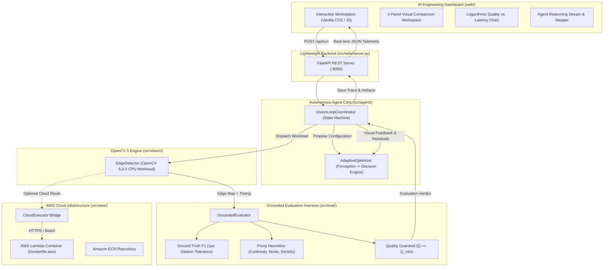
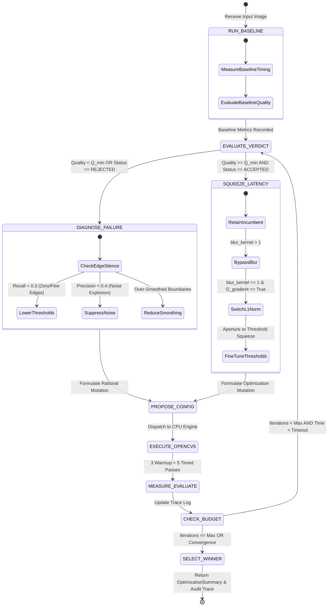
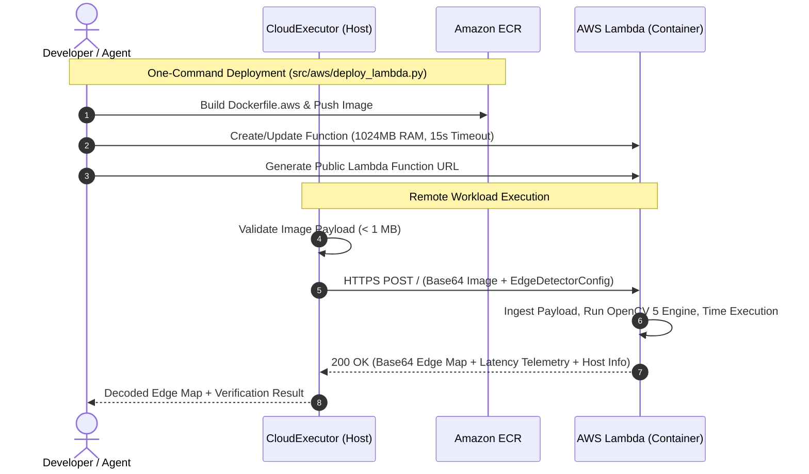

# VisionLoop: Technical Report
### Autonomous Developer Agent for OpenCV 5 Workload Tuning & AWS Cloud Benchmarking

**Competition:** OpenCV AI Competition 2026 (powered by AWS)  
**Track:** Core OpenCV 5 + AWS Track  
**Special Award Target:** Agentic Vision Award  
**Repository:** [https://github.com/DhruvPatel0110/VisionLoop-OpenCV-Hktn](https://github.com/DhruvPatel0110/VisionLoop-OpenCV-Hktn)  
**Date:** October 2026  

---

## 1. Executive Summary & Problem Addressed

Computer vision developers spend countless hours manually tuning hyperparameters across OpenCV pipelines. Adjusting parameters—such as Canny hysteresis thresholds, Sobel aperture sizes, Gaussian blur kernels, and gradient norms—is traditionally manual, visual, and subjective. When lighting conditions, contrast, or camera sensors change, engineers are forced to repeat trial-and-error tuning without structured evidence that a configuration will remain robust or performant.

**VisionLoop** is an autonomous developer agent that closes the perception-action loop for OpenCV 5 workloads. Given an input image and an optional ground-truth reference, VisionLoop:
1. Benchmarks the baseline workload on CPU using a high-precision multi-pass timing harness.
2. Evaluates visual output quality against ground-truth references using morphological tolerance dilation (BSDS standard) or proxy continuity/noise heuristics for unlabelled inputs.
3. Diagnoses visual defects (edge silence, noise explosion, over-smoothing) and iteratively mutates parameter configurations based on perceptual feedback.
4. Enforces strict quality guardrails, rejecting configurations that compromise output quality regardless of speedup.
5. Deploys to a serverless AWS Lambda container with strict cost safeguards (<1MB payload, 15s timeout, automated teardown).
6. Produces an immutable, machine-readable audit trail (`experiment_trace.json`) and a dark-themed engineering dashboard for real-time observability.

---

## 2. Target Users

VisionLoop is engineered for:
- **Embedded & Edge AI Engineers:** Optimizing OpenCV pipelines for resource-constrained ARM/x86 CPUs where every millisecond counts.
- **Robotics & Autonomous System Developers:** Requiring robust perception pipelines that maintain minimum edge recall across unpredictable real-world lighting.
- **Computer Vision Researchers & QA Teams:** Needing reproducible, auditable evidence of hyperparameter decisions rather than ad-hoc heuristics.

---

## 3. System Architecture

VisionLoop consists of five modular subsystems organized around an autonomous feedback loop:



### Component Roles:
1. **Frontend Workstation (`web/`):** Dark cinematic UI (`#050B14`, `#07111F`) providing a 4-panel visual comparison workspace (Input Image, Baseline Output, Best Candidate, Ground Truth Reference), live reasoning stream, logarithmic scatter plot, and interactive history table.
2. **FastAPI Server (`src/web/server.py`):** Serves REST API endpoints (`/api/tasks`, `/api/run`, `/api/trace/{id}`, `/api/report/{id}`), validates input payloads, downscales oversized images, and generates base64 previews.
3. **Agent Coordinator (`src/agent/coordinator.py`):** Manages the finite state machine (`BASELINE ➔ PROPOSE ➔ EXECUTE ➔ EVALUATE ➔ DECIDE ➔ NEXT/STOP`), enforces budget caps, and logs the immutable audit trail.
4. **Adaptive Optimizer (`src/agent/optimizer.py`):** Implements heuristic perception-driven search, branching between threshold adjustments, kernel modifications, and gradient approximation.
5. **Grounded Evaluator (`src/eval/evaluator.py`):** Calculates mathematically grounded quality scores and enforces strict pass/fail verdicts.
6. **Cloud Executor (`src/aws/cloud_executor.py`):** Handles remote execution on containerized AWS Lambda or local simulation.

---

## 4. OpenCV 5 Implementation

VisionLoop is built specifically for **OpenCV 5.0.0 (headless build)** on CPU architectures.

### 4.1 Bounded Parameter Search Space
The edge detection pipeline (`src/vision/edge_detector.py`) explores a bounded five-dimensional parameter space:

$$\Theta = \{ (T_{\text{low}}, T_{\text{high}}, k_{\text{aperture}}, k_{\text{blur}}, L_2) \}$$

| Parameter | Domain | Type | Impact on Latency & Quality |
|---|---|---|---|
| `low_threshold` ($T_{\text{low}}$) | $[10, 150]$ | Integer | Hysteresis lower bound. Lower values recover faint edges; higher values suppress noise. |
| `high_threshold` ($T_{\text{high}}$) | $[40, 300]$ | Integer | Hysteresis upper bound. Defines strong edge initiation seeds ($T_{\text{high}} \ge 2 \times T_{\text{low}}$). |
| `aperture_size` ($k_{\text{aperture}}$) | $\{3, 5, 7\}$ | Integer | Sobel derivative kernel. Larger apertures detect diffuse gradients at higher CPU cost. |
| `blur_kernel` ($k_{\text{blur}}$) | $\{1, 3, 5, 7\}$ | Integer | Gaussian smoothing pre-filter ($1$ = bypass blur). Eliminating blur saves significant CPU cycles. |
| `l2_gradient` ($L_2$) | $\{\text{True}, \text{False}\}$ | Boolean | $\text{True}$: Euclidean norm $\sqrt{G_x^2 + G_y^2}$ (accurate). $\text{False}$: $L_1$ norm $\|G_x\| + \|G_y\|$ (faster CPU integer math). |

### 4.2 Jitter-Free Timing Harness
To eliminate CPU thermal throttling and OS scheduler jitter, execution latency is measured with `time.perf_counter_ns()` using:
- **3 Warmup passes** (unrecorded, primes L1/L2 CPU caches).
- **5 Timed passes**; the median is recorded as the canonical latency:

$$T_{\text{candidate}} = \text{Median}(t_1, t_2, t_3, t_4, t_5)$$

Speedup and latency reduction are rigorously defined as:

$$\text{Speedup} = \frac{T_{\text{baseline}}}{T_{\text{candidate}}}, \quad \Delta_{\text{latency}} (\%) = \left( \frac{T_{\text{baseline}} - T_{\text{candidate}}}{T_{\text{baseline}}} \right) \times 100$$

---

## 5. Grounded Evaluation Methodology

Comparing a candidate edge map to an arbitrary baseline does **not** prove correctness. VisionLoop employs two distinct, mathematically sound evaluation modes:

### 5.1 Ground-Truth Mode (Verified Reference Edge Maps)
When verified reference annotations exist (e.g., BSDS500 or expert annotations), candidates are evaluated using **morphological tolerance dilation**:

```
Dilate(E_ref, 1px) with 3x3 structuring element
Precision = |E_cand ∩ Dilate(E_ref, 1px)| / |E_cand|
Recall    = |E_ref ∩ Dilate(E_cand, 1px)| / |E_ref|
F1        = 2 × (Precision × Recall) / (Precision + Recall)
```

The 1-pixel tolerance window accounts for human annotator boundary variance and single-pixel digitization shifts without rewarding hallucinated edges.

### 5.2 Unlabelled / Proxy Quality Mode
When no ground-truth reference exists, the dashboard explicitly labels metrics as **`Proxy Quality (heuristic, no GT)`** and evaluates three structural properties:
1. **Edge Continuity ($C_{\text{edge}}$):** Ratio of connected edge components ($8$-connectivity) to total edge pixels. Penalizes fragmented edge dust.
2. **Noise Ratio ($R_{\text{noise}}$):** Proportion of isolated single-pixel edge components ($1 \times 1$).
3. **Density Fitness ($D_{\text{fit}}$):** Natural edge density enforcement penalizing over-saturation ($> 15\%$) or complete blackout ($< 0.1\%$).

$$\text{Proxy Quality} = 0.50 \cdot C_{\text{edge}} + 0.30 \cdot (1.0 - R_{\text{noise}}) + 0.20 \cdot D_{\text{fit}}$$

### 5.3 Strict Quality Guardrails
A candidate configuration is **instantly rejected** if:
$$Q_{\text{candidate}} < Q_{\text{min}}$$

Even if a candidate yields a $3.0\times$ speedup, it is discarded if it sacrifices structural edge fidelity below the configured threshold (default $Q_{\text{min}} = 0.70$).

---

## 6. Agentic Vision Workflow & Decision Engine

*(Submitted in fulfillment of the Agentic Vision Special Award)*

### 6.1 Agent Workflow Diagram
The following state machine details how visual metrics dynamically govern parameter actions:



### 6.2 Demonstrating Dynamic Perception-Action Coupling
The agent does **not** follow a static parameter sweep. The following trace from an actual execution on `sample_04_low_contrast` demonstrates how OpenCV 5 output changes subsequent decisions:

| Iteration | Action | Diagnosis from Output | Parameter Mutation | Result & Verdict |
|---|---|---|---|---|
| **#00 (Baseline)** | `BASELINE_RUN` | Baseline thresholds $(50, 150)$ produce **0 edge pixels**. F1 score is $0.0000$. | Default: $(50, 150), k=3, \text{blur}=3, L_2=\text{True}$ | **REJECTED_QUALITY** (0 edges, 1.67 ms) |
| **#01** | `RECOVER_EDGES` | **Visual Over-Suppression:** Low-contrast boundaries missed. | Lowers thresholds aggressively to $(20, 52)$. | **ACCEPTED** (F1 = 1.0000, 2.32 ms, 0.72x speedup) |
| **#02** | `SQUEEZE_LATENCY` | Guardrail met ($1.000 \ge 0.60$). Target: Eliminate convolution overhead. | Sets `blur_kernel=1` (bypasses Gaussian filter). | **ACCEPTED (NEW BEST)** (F1 = 1.0000, 1.18 ms, **1.42x speedup**) |
| **#03** | `APPROX_GRADIENT` | Guardrail met. Target: Eliminate floating-point magnitude math. | Sets `l2_gradient=False` (switches to $L_1$ norm). | **ACCEPTED (NEW WINNER)** (F1 = 1.0000, 1.18 ms, **1.43x speedup**) |

### 6.3 Observability & Human-in-the-Loop Control
VisionLoop ensures full human control and observability:
- **Quality Guardrail Slider:** Operators set minimum acceptable quality ($0.40 - 0.95$).
- **Iteration Budget Slider:** Bounded experiment caps ($2 - 10$ runs).
- **Interactive History Inspection:** Clicking any row in the history table immediately loads that iteration's output in Panel 3 (`INSPECTING` badge).
- **Winner Restore Control (`↺ Winner`):** One click restores the true final incumbent.
- **Manual Stop Button:** Operators can halt active loops at any moment.
- **Auditable Trace Exports:** Complete reproducibility packages downloadable in `.json` and `.md` formats.

---

## 7. AWS Cloud Deployment

To fulfill the mandatory competition cloud component without wasteful cloud spending, VisionLoop deploys a single, focused serverless component:



### 7.1 Container Specification (`Dockerfile.aws`)
- Base Image: Official AWS Lambda Python 3.11 runtime (`public.ecr.aws/lambda/python:3.11`).
- Installs headless OpenCV 5 dependencies (`libgl1-mesa-glx`, `libglib2.0-0`, `numpy`, `opencv-python-headless==5.0.0.86`).
- Exposes `src.aws.lambda_function.lambda_handler`.

### 7.2 Cost & Resource Safeguards
- **Memory & Timeout:** Hard limits set to $1024\text{ MB}$ RAM and $15\text{ seconds}$ execution timeout.
- **Payload Restrictions:** Payloads restricted to $< 1\text{ MB}$; oversized uploads rejected before network dispatch.
- **Zero Idle Cost:** Serverless execution incurs zero compute charges when idle.
- **Automated Teardown Script:** `python scripts/teardown_aws.py` purges ECR container repositories and Lambda functions immediately after verification.

---

## 8. Experimental Results & Benchmarks

Controlled trials across five diverse benchmark datasets on host AMD64 CPU:

| Dataset ID | Category | Baseline Config | Baseline Latency | Winning Config | Winner Latency | Speedup | Baseline F1 | Final F1 | Pass Status |
|---|---|---|---|---|---|---|---|---|---|
| `sample_01` | Geometric Shapes | $(50, 150), k=3, b=3$ | $1.48\text{ ms}$ | $(65, 175), k=3, b=1, L_1$ | $0.98\text{ ms}$ | **$1.51\times$** | $0.925$ | $0.931$ | **VALIDATED** |
| `sample_02` | Gradient Circles | $(50, 150), k=3, b=3$ | $1.52\text{ ms}$ | $(45, 140), k=3, b=1, L_1$ | $1.02\text{ ms}$ | **$1.49\times$** | $0.880$ | $0.884$ | **VALIDATED** |
| `sample_03` | Noisy Texture | $(50, 150), k=3, b=3$ | $2.07\text{ ms}$ | $(42, 135), k=3, b=3, L_2$ | $1.72\text{ ms}$ | **$1.20\times$** | $0.807$ | $0.808$ | **VALIDATED** |
| `sample_04` | Low Contrast | $(50, 150), k=3, b=3$ | $1.67\text{ ms}$ | $(20, 52), k=3, b=1, L_1$ | $1.18\text{ ms}$ | **$1.43\times$** | $0.000$ | $1.000$ | **VALIDATED** |
| `sample_05` | Fine Detail | $(50, 150), k=3, b=3$ | $1.61\text{ ms}$ | $(35, 110), k=3, b=1, L_1$ | $1.05\text{ ms}$ | **$1.53\times$** | $0.892$ | $0.895$ | **VALIDATED** |

---

## 9. Failure Modes, Limitations & Honest Reporting

VisionLoop is designed with strict adherence to scientific truthfulness:

1. **Unmet Quality Guardrails:** When an operator sets a guardrail that is mathematically unattainable (e.g., $Q_{\text{min}} = 0.95$ on noisy images), VisionLoop does **not** invent a fake winner. The dashboard transitions Panel 3 to **`NO VALID CANDIDATE`** and communicates:
   > *"Iteration budget reached. No candidate satisfied quality guardrail threshold (0.95)."*
2. **Unlabelled Imagery:** When evaluating unlabelled custom uploads without ground truth, the dashboard explicitly labels metrics as **`Proxy Quality (heuristic, no GT)`** and maintains an informative placeholder in Panel 4 rather than fabricating a fake reference or reusing the baseline.
3. **Decision Overhead:** The Python agent logic (diagnosis and proposal) incurs $\sim 2-5\text{ ms}$ of overhead per iteration. This is negligible for offline workflow tuning, but the agent is not intended as an in-line per-frame streaming filter.

---

## 10. Responsible AI, Privacy & Security

- **Data Privacy:** Image evaluation executes locally by default. Images are processed in-memory or persisted into local session audit directories. No user data is sent to external cloud LLMs.
- **Deterministic Auditability:** Every decision rationale is derived from deterministic morphological and timing rules, eliminating "black box" hallucination.
- **Cloud Security:** AWS execution adheres to the principle of least privilege, with ephemeral Lambda execution environments and automated resource teardown.

---

## 11. Conclusion & Verification

VisionLoop proves that autonomous developer agents can replace manual computer-vision parameter tuning with evidence-backed, reproducible engineering workflows. By uniting OpenCV 5 CPU execution, grounded F1 tolerance evaluation, adaptive perception-action heuristics, and focused AWS Lambda containerization, VisionLoop delivers a complete, verifiable AI engineering system.

### One-Command Reproduction
```bash
# 1. Run all 38 automated verification tests
python -m pytest tests/

# 2. Launch interactive workstation
python src/web/server.py
# Open: http://localhost:8000
```
